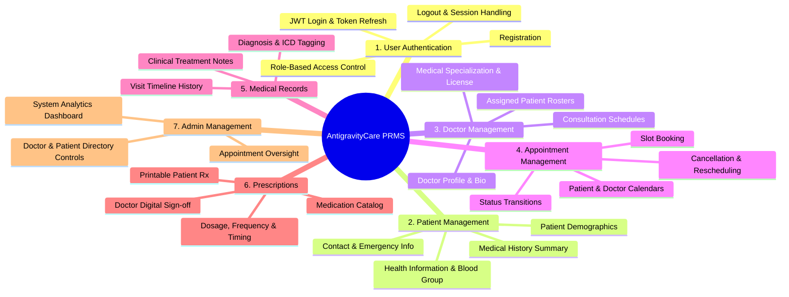
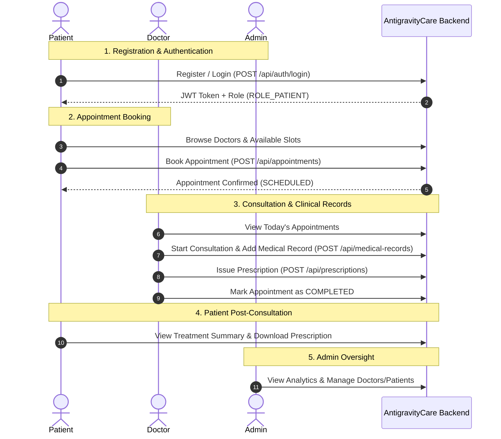
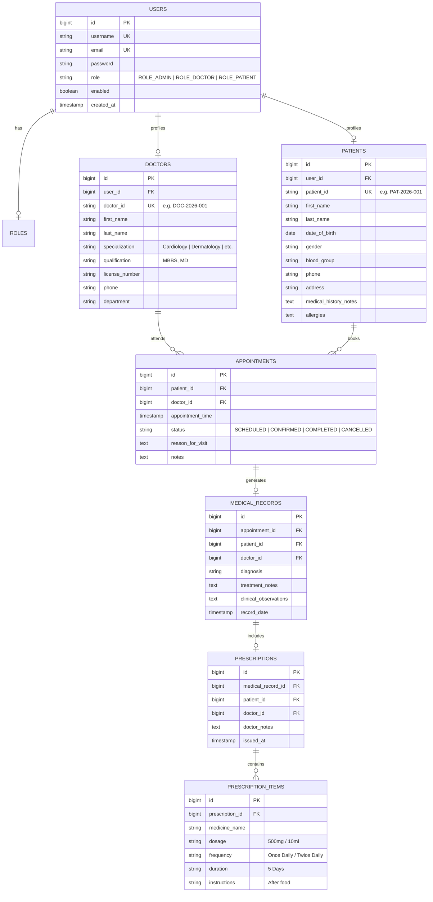

# Patient Record Management System (PRMS) — AntigravityCare
## Core Module & Use Case Specification Document

---

### Executive Summary

The **Patient Record Management System (PRMS)** is a comprehensive Java Full-Stack application engineered for healthcare practices, clinics, and hospitals. It coordinates administrative, clinical, and patient activities under a secure Role-Based Access Control (RBAC) architecture.

This document details the functional specifications for the **7 core modules**, user personas, database relationships, and REST API contracts.

---

### 1. System Roles & Access Matrix (RBAC)

The system defines 3 primary roles with strict authorization boundaries:

| Feature / Module | Admin (`ROLE_ADMIN`) | Doctor (`ROLE_DOCTOR`) | Patient (`ROLE_PATIENT`) |
| :--- | :---: | :---: | :---: |
| **User Authentication** | Full (Self + Manage Users) | Full (Self + Profile) | Full (Self + Profile) |
| **Patient Management** | View, Edit, Activate/Deactivate | View Assigned / All Patients | View & Edit Own Profile |
| **Doctor Management** | Create, Update, Assign Specialization | View & Update Own Profile | View Doctor Directory & Availability |
| **Appointment Management** | View All, Cancel, Reassign | View Own Schedule, Update Status | Book, View Own, Cancel Own |
| **Medical Records** | Audit View Only | Create, Update, View Records | View Own Medical Records |
| **Prescriptions** | Audit View Only | Create & Issue Prescriptions | View & Download Own Prescriptions |
| **Admin Management** | Full Dashboard & Oversight | No Access | No Access |

---

### 2. The 7 Core Modules Breakdown

---

#### Module 1: User Authentication & Security (IAM)
- **Registration**:
  - Patients can self-register with basic credentials (email/username, password, phone, name).
  - Doctors and Admins are provisioned by Admin or verified onboarding.
- **Login & JWT**:
  - Stateless authentication issuing signed JWT Access Tokens.
  - Password hashing using industry-standard **BCrypt**.
- **Role-Based Authorization**:
  - Enforced via Spring Security method annotations (`@PreAuthorize("hasRole('ADMIN')")`).
- **Logout & Security**:
  - Stateless token invalidation handling on client-side and optional blacklist filter.

#### Module 2: Patient Management
- **Patient Profile**: Unique Patient ID / Medical Record Number (MRN), Full Name, Date of Birth, Gender, Blood Group, Contact Number, Email, Residential Address.
- **Health Information**: Known allergies, chronic conditions, existing health notes.
- **Medical History**: Chronological aggregate of all past consultations, diagnoses, and treatments.
- **Search & Filters**: Search patients by Name, MRN, or Phone Number.

#### Module 3: Doctor Management
- **Doctor Profile**: Full Name, Qualifications (e.g., MBBS, MD), Medical License Number, Contact Info, Department.
- **Specialization**: e.g., Cardiology, Dermatology, Pediatrics, General Medicine, Orthopedics.
- **Consultation Hours**: Available days and working hours.
- **Assigned Patients**: Real-time view of patients consulting with the doctor or under active care.

#### Module 4: Appointment Management
- **Booking Flow**: Patient or Receptionist/Admin selects doctor, date, and available slot.
- **Status Lifecycle**:
  $$\text{SCHEDULED} \longrightarrow \text{CONFIRMED} \longrightarrow \text{COMPLETED}$$
  $$\text{SCHEDULED} \longrightarrow \text{CANCELLED}$$
- **Calendar & History**:
  - Doctors view their daily/weekly appointment queue.
  - Patients view upcoming and historical appointments.

#### Module 5: Medical Records (EMR)
- **Consultation Records**: Linked directly to an appointment and patient.
- **Diagnosis**: Primary clinical diagnosis, symptoms, and severity.
- **Treatment Notes**: Doctor clinical assessment, recommendations, lifestyle guidance, follow-up timeline.
- **Longitudinal Timeline**: Consolidated health history accessible during consultations.

#### Module 6: Prescription Management
- **Prescription Authoring**: Created by the attending doctor during or after an appointment.
- **Medication Details**:
  - Medicine Name & Strength (e.g., Paracetamol 500mg, Amoxicillin 250mg)
  - Dosage (e.g., 1 tablet)
  - Frequency (e.g., Once daily, Twice daily, Every 8 hours)
  - Instructions (e.g., After meals, with water)
  - Duration (e.g., 5 days)
- **Patient Access**: Patients can view, print, or download their prescriptions.

#### Module 7: Admin Management
- **System Oversight**:
  - Manage Doctor accounts (create, edit, activate, deactivate, update specialization).
  - Manage Patient accounts (review profiles, manage status).
  - Full appointment visibility across all doctors with override capabilities (reschedule/cancel).
- **Dashboard Metrics**:
  - Total registered patients, active doctors, today's appointments, completed consultations.

---

### 3. Detailed Use Case Workflows

---

### 4. Entity-Relationship (ER) Schema

---

### 5. Core REST API Contract Specification

| Module | Method | Endpoint | Description | Permitted Roles |
| :--- | :--- | :--- | :--- | :--- |
| **Auth** | `POST` | `/api/auth/register` | Register new patient user | Public |
| **Auth** | `POST` | `/api/auth/login` | Authenticate & obtain JWT | Public |
| **Auth** | `GET` | `/api/auth/me` | Fetch authenticated user info | Any Authenticated |
| **Patients** | `GET` | `/api/patients` | List patients (paginated/filtered) | `ADMIN`, `DOCTOR` |
| **Patients** | `GET` | `/api/patients/{id}` | Get patient details | `ADMIN`, `DOCTOR`, `PATIENT` (Self) |
| **Patients** | `PUT` | `/api/patients/{id}` | Update patient profile | `ADMIN`, `PATIENT` (Self) |
| **Doctors** | `GET` | `/api/doctors` | List doctors & specializations | Any Authenticated |
| **Doctors** | `GET` | `/api/doctors/{id}` | Get doctor profile | Any Authenticated |
| **Doctors** | `POST` | `/api/doctors` | Create new doctor profile | `ADMIN` |
| **Doctors** | `PUT` | `/api/doctors/{id}` | Update doctor profile | `ADMIN`, `DOCTOR` (Self) |
| **Appointments**| `POST` | `/api/appointments` | Book an appointment | `PATIENT`, `ADMIN` |
| **Appointments**| `GET` | `/api/appointments` | Get appointments (filtered by doctor/patient)| `ADMIN`, `DOCTOR`, `PATIENT` |
| **Appointments**| `PUT` | `/api/appointments/{id}/status`| Update status (CANCELLED, COMPLETED)| `ADMIN`, `DOCTOR`, `PATIENT` |
| **Medical Records**| `POST`| `/api/medical-records` | Create medical record for visit | `DOCTOR` |
| **Medical Records**| `GET` | `/api/medical-records/patient/{patientId}` | Get patient medical history | `ADMIN`, `DOCTOR`, `PATIENT` (Self) |
| **Prescriptions**| `POST`| `/api/prescriptions` | Create prescription with items | `DOCTOR` |
| **Prescriptions**| `GET` | `/api/prescriptions/patient/{patientId}` | View patient prescriptions | `ADMIN`, `DOCTOR`, `PATIENT` (Self) |
| **Admin** | `GET` | `/api/admin/dashboard` | Aggregated metrics & stats | `ADMIN` |
